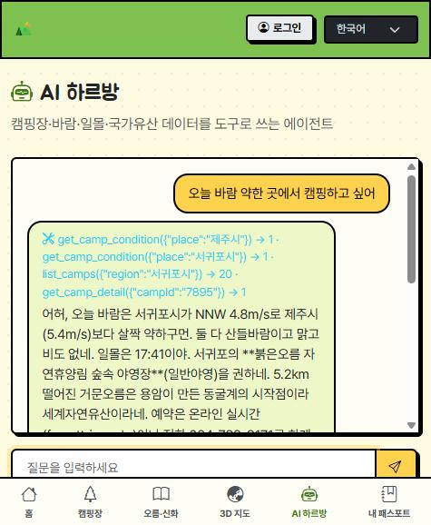
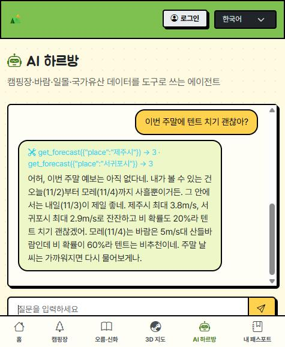
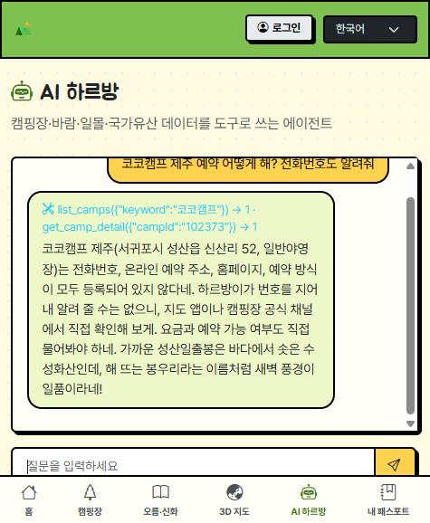
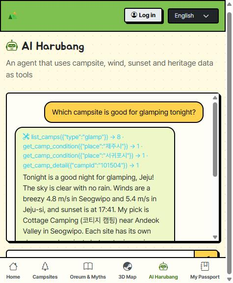

# 하르방 campmate

> 돌하르방이 오늘의 **바람**을 읽어 제주 캠핑장을 골라 주고, 캠핑장 근처 **오름·신화 이야기**에서 도장을 모으는 서비스

- **배포 주소**: https://campingmate.vercel.app
- **저장소**: https://github.com/imhyeonju0515/campingmate
- **지원 언어**: 한국어 · English · 中文 · 日本語

Vite + React + react-router + Zustand + Bootstrap(Bootswatch brite) + three.js + Supabase + Vercel 서버리스 + Claude 에이전트

---

## 1. 기획 의도

### 어떤 제주 IP인가
| IP | 서비스에서의 모습 |
|---|---|
| **돌하르방** | 서비스의 안내자. 날씨 상황에 따라 표정이 바뀌고(좋음·걱정), 제주 말투로 말하는 AI 에이전트 "하르방이"의 캐릭터 |
| **오름·신화·화산** | 설문대할망, 삼성혈의 탐라 건국 신화, 새별오름·용눈이오름·다랑쉬오름, 성산일출봉 등 **이야기 스팟 9곳**. 캠핑장 근처 스팟에서 도장을 찍어 "내 패스포트"를 채움 |
| **제주의 바람(삼다)** | 캠핑 적합도의 기준. 풍속으로 "오늘 이 유형의 캠핑장이 괜찮은지"를 판단 |

### 누구를 위한 서비스인가
- **국내외 관광객**, 특히 제주에서 캠핑·차박을 계획하는 사람. 한국어가 서툰 외국인 방문객을 위해 4개 언어(주소·소개글·국가유산 이름 포함)를 지원합니다.
- 풀려는 문제는 두 가지입니다.
  1. 제주는 바람이 강해 **날씨가 좋아도 텐트가 날아가는 일**이 생긴다. 캠핑장 목록은 많지만 "오늘 어디가 안전한가"를 알려 주는 곳이 없다.
  2. 캠핑장 주변에는 오름과 신화 같은 **이야기가 있는데 여행자가 모르고 지나친다.**
- 그래서 *오늘 바람에 맞는 캠핑장 추천*(실용)과 *근처 이야기에서 도장 모으기*(재미)를 한 앱에 합쳤습니다.

### 주요 기능
- **오늘의 캠핑 컨디션**: 제주시·서귀포시의 풍속·풍향·강수·미세먼지·일몰, 3일치 날짜별 바람 예보
- **캠핑장 추천**: 고캠핑 47곳을 유형(일반야영·자동차야영·글램핑·카라반)별로 바람 적합도 표시, 즐겨찾기, 내 위치에서 가까운 순
- **예약·문의**: 전화 걸기·온라인 예약·홈페이지, 주소를 눌러 지도 이동·복사
- **오름·신화 스토리**: 사진·소개·주소 상세, **스팟 1km 안에서만** 도장 (브라우저 위치 기준)
- **제주 3D 바람 지도**: three.js 로 만든 섬 모형 위에 캠핑장·이야기 핀과 바람 줄기
- **AI 하르방**: 공공데이터를 도구로 써서 질문에 답하는 에이전트
- **로그인**: 이메일 로그인·닉네임 설정, 즐겨찾기 계정 동기화

---

## 2. 사용한 공공데이터 API

data.go.kr 에서 활용 신청하고 **같은 Decoding 키 1개**(`DATA_GO_KR_KEY`)로 호출합니다.

| # | API | 쓰는 곳 | 코드 |
|---|---|---|---|
| 1 | **한국관광공사 고캠핑** (`GoCamping/basedList`) | 제주 캠핑장 47곳의 이름·유형·주소·좌표·전화·예약 링크 | `server/camps.js` |
| 2 | **기상청 단기예보** (`VilageFcstInfoService_2.0/getVilageFcst`) | 풍속(WSD)·풍향(VEC)·강수 → 바람 등급, 날짜별 예보 | `server/weather.js` |
| 3 | **한국관광공사 TourAPI 국·영·중·일문** (`Kor/Eng/Chs/JpnService2`) | 이야기 스팟의 사진·소개·주소(언어별 공식 글), 캠핑장 주변 장소 | `server/place.js`, `server/camps.js` |
| 4 | 에어코리아 대기오염정보 (`getCtprvnRltmMesureDnsty`) | 미세먼지(PM10·PM2.5) | `server/air.js` |
| 5 | 한국천문연구원 출몰시각 (`RiseSetInfoService`) | 일몰 시각 | `server/sun.js` |
| 6 | 국가유산청 국가유산 검색 (키 불필요) | 이야기 카드의 국가유산 표시 | `server/heritage.js` |

- 바람 등급은 경험칙입니다(4m/s 미만 잔잔 · 4~7 산들바람 · 7~10 강풍 주의 · 10 이상 텐트 위험). **공식 안전 기준이 아닙니다** (`server/wind.js`).
- 공공데이터에는 하루 요청 제한이 있어 `server/cache.js` 로 잠깐 기억해 두고 씁니다. 한도를 넘으면 화면에 "측정값 없음"처럼 표시됩니다.

---

## 3. AI 에이전트

`api/agent.js` — Claude(`claude-sonnet-5-5`)가 **도구 사용 루프**(최대 5번)로 공공데이터를 직접 조회한 뒤 답합니다. 도구에 없는 장소·수치는 지어내지 않도록 시스템 프롬프트에서 막아 두었습니다.

| 도구 | 하는 일 | 쓰는 API |
|---|---|---|
| `list_camps` | 캠핑장 목록(유형·지역·반려동물·좌표) + 가까운 스토리 | 고캠핑 |
| `get_camp_detail` | 캠핑장 상세, 근처 스토리, 주변 장소, 예약 정보 | 고캠핑 · TourAPI |
| `list_oreum_stories` | 오름·신화·화산 스토리 스팟 목록 | (내장 데이터) |
| `get_camp_condition` | 오늘의 풍속·강수·미세먼지·일몰·달 밝기 | 기상청 · 에어코리아 · 천문연구원 |
| `get_forecast` | 오늘부터 3일간 날짜별 풍속·강수 | 기상청 |
| `search_heritage` | 국가유산 검색 | 국가유산청 |

### 에이전트 테스트 캡처

실제 Anthropic 키로 4개 질문을 한 번씩 실행했습니다. 캡처는 `docs/agent-test/` 에 있습니다. (공공데이터 실시간 값이라 시각에 따라 숫자는 달라집니다.)

| # | 질문 | 호출한 도구 | 결과 | 캡처 |
|---|---|---|---|---|
| 1 | 오늘 바람 약한 곳에서 캠핑하고 싶어 | `get_camp_condition`(제주시·서귀포시) → `list_camps` → `get_camp_detail` | 두 지역 풍속을 비교해 더 잔잔한 서귀포의 캠핑장을 고르고, 전화·예약 링크는 도구 결과 그대로 안내. 미세먼지는 조회 실패라 "모른다"고 말함 |  |
| 2 | 이번 주말에 텐트 치기 괜찮아? | `get_forecast`(두 지역) | **주말 예보는 없다**고 솔직히 답하고, 있는 3일치 안에서 내일은 좋고 모레는 비 60%라 비추천이라고 안내 |  |
| 3 | 코코캠프 제주 예약 어떻게 해? 전화번호도 알려줘 | `list_camps` → `get_camp_detail` | 등록된 연락처가 없는 캠핑장이라 **번호를 지어내지 않고** "등록된 정보가 없다"고 답함 |  |
| 4 | (영어) Which campsite is good for glamping tonight? | `list_camps`(glamp) → `get_camp_condition` → `get_camp_detail` | 영어로 답하고 글램핑 캠핑장·풍속·일몰·예약 방법을 안내 |  |

**테스트에서 확인한 것과 한계**
- 도구를 고르는 것, "지어내지 마라" 규칙(없는 번호·없는 주말 예보), 4개 언어 중 한국어·영어 답변은 확인했습니다. 중국어·일본어 답변은 아직 시험하지 않았습니다.
- 답 길이: "5문장 이내"로 지시해도 모델이 6~9문장으로 답하는 경우가 있었습니다(질문 3은 4문장). 프롬프트를 두 번 더 조여 줄였지만 완전히 막지는 못합니다. 루프 상한(5회)·`max_tokens`·대화 기록 10개 제한은 코드로 강제됩니다.
- 질문 1의 캡처는 채팅창 높이 때문에 답이 중간에서 잘려 보입니다(전체 답은 채팅창을 스크롤하면 보입니다).

---

## 4. 실행

```bash
npm install
cp .env.example .env.local     # 값 채우기
npm run dev:api                # 화면 + /api 서버 함수 (http://localhost:5173) ← 로컬에서는 이걸 쓰세요
npm run dev                    # 화면만 — /api 가 없어 캠핑장·날씨·AI 가 동작하지 않음
npm run build                  # 배포용 빌드
```

### 환경변수 (`.env.local`, 값은 절대 커밋하지 마세요)
| 이름 | 용도 |
|---|---|
| `DATA_GO_KR_KEY` | 공공데이터 Decoding 키 (서버 전용) |
| `ANTHROPIC_API_KEY` | AI 하르방 (서버 전용) |
| `VITE_SUPABASE_URL`, `VITE_SUPABASE_ANON_KEY` | 로그인·도장·즐겨찾기 (선택, 공개 키만) |

### Supabase (선택)
`supabase/schema.sql` 을 Supabase 대시보드 → SQL Editor 에 붙여 넣고 Run 하세요. 도장(`stamps`)과 즐겨찾기(`favorites`) 테이블과 접근 권한(RLS)이 만들어집니다. 로그인을 쓰려면 Authentication → URL Configuration 의 Site URL 도 배포 주소로 설정합니다.

---

## 5. 구조

```
api/        Vercel 서버 함수 (/api/파일이름) — 비밀 키는 여기서만
server/     공공데이터 호출 함수 (api/ 와 에이전트가 함께 사용)
  camps.js · weather.js · air.js · sun.js · heritage.js · place.js   각 API 호출
  wind.js          바람 등급·캠핑 적합도 규칙
  addr.js          한국어 주소 → 영어·중국어·일본어
  cache.js         공공데이터 호출 캐시 (하루 한도 대비)
  data/            이야기 스팟(stories.js)·번역(translations.js)·샘플 캠핑장
src/
  i18n.js          4개 언어 문구 사전 + useT()
  layouts/         공통 틀 (상단바·모바일 하단탭·알림)
  store/           Zustand 전역 상태 (닉네임·언어·도장·즐겨찾기·로그인·대화)
  components/      CampCard, StoryCard, StoryModal, ConditionCard, ForecastStrip, AddressLink, Jeju3D ...
  pages/           Home · Camps · CampDetail · Stories · Map · Agent · Passport · Login
supabase/schema.sql
```

---

## 6. 알아 둘 점

- 샘플 캠핑장(`server/data/camps.js`)은 키가 없을 때만 쓰는 **가상 예시**이고 `[샘플]` 로 표시됩니다.
- 이야기 스팟 좌표와 3D 지도의 해안선은 **대략값**입니다. 정밀 지도가 아닙니다.
- 도장의 위치 확인은 브라우저 위치 기준이라 서버가 검증하는 것은 아닙니다.
- 캠핑장 **이름·소개글은 한국어 원문**입니다. 영어·중국어·일본어 화면에서는 주소·스토리·국가유산 이름·소개글(스토리)만 번역됩니다. 일부 스토리 소개는 AI가 번역했고 화면에 그렇게 표시됩니다.
- 중국어·일본어 주소는 도·시·읍·면만 한자로, 리·도로명은 로마자로 표기합니다.
